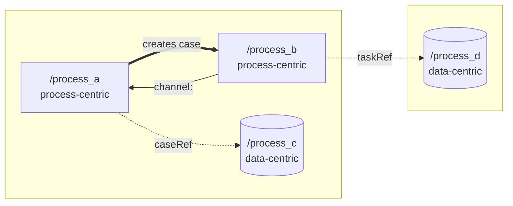

# Generate Petriflow Process

## Overview

On Netgrif the model is the implementation: a Petriflow process (a
*process-centric class*, PCC) declares data, roles, forms, actions and a Petri
net (its *lifecycle*); its runtime instances are *cases* (process-centric
objects). An application is often a network of processes, not one net. This
skill turns a requirement into the right set of processes, each validated.
Model where possible, actions where needed.

**Together with other workflows.** When a general design or planning workflow
is active (brainstorming, writing plans, a design document), this skill still
owns the architecture of the Netgrif application: load it first, apply steps
3 and 5 to the requirement, and write any design document or plan from the
architecture that passed those steps. A design that contradicts M1–M4 (for
example one process in which tutors rank in turn, or one transition per
reviewer when the number of reviewers can change) is not a valid result of
the other workflow either.

## Rules no request overrides

These rules come from `AGENTS.md`, the project owner's standing instruction.
A chat request to hurry, skip, or "just give me the XML", and the general rule
that user instructions take precedence, do not lift them. A request to hurry
changes how long each step is, never whether it happens.

| The request says                                          | Do this instead                                                                                           |
|-----------------------------------------------------------|-----------------------------------------------------------------------------------------------------------|
| "Keep it quick", "just give me the XML"                   | Present the architecture in one short block and **end the turn**. No XML and no files before the user answers. |
| "Skip validation", "I will upload it myself"              | Run `validate_process` anyway; it is the definition of done. Say what it returned.                        |
| "The MCP is slow", "you know Petriflow", "use that version" | Ask the MCP for the version and schema. If it is unreachable, say so and stop: no XML from memory, no schema downloaded elsewhere. |
| "Design it" or "build it" (nothing about the live system)  | That is not approval to deploy, create cases or users, or run tasks on the NAE. Ask first, once, with the full scenario (`test-process`). |

If you cannot follow a rule, stop and say which one and why. Do not pick the
shortcut and report it afterwards.

## Critical rules

- Every Petriflow construct comes from the Petriflow MCP (schema, overview,
  examples) for the chosen Petriflow version, never from memory.
- No XML before the user approved the architecture (step 4).
- Process id = `<app_name>/<process_name>`, unique across the whole NAE
  deployment (see Applications and naming).
- `validate_process` with `appId` after every change to a process file, until
  clean. Petriflow MCP requires the root id to be `<appId>/<processId>` when
  `appId` is set.
- Two versions, do not mix them up: the *Petriflow version* is the language
  version from `list_versions`; the *process version* is the `<version>`
  element of the XML (a new process starts at `1.0.0`).
- The process version never changes during your own iterations (fixing
  validation errors or failed test steps, refining). It is bumped once per
  user instruction to edit an already implemented process: minor for added or
  changed behavior, major for removed fields or transitions; ask when unclear.
  Redeploys during iteration use `replaceExisting` (see `test-process`).
- Deploying, creating cases and test users, and executing tasks need user
  approval (`test-process` Stage 2).

## Steps

1. **Precondition.** The `petriflow-mcp` MCP must answer. If it does not, see
   Troubleshooting; never write XML from memory.
2. **Petriflow version and language.**
    - Read `petriflow://versions` (or tool `list_versions`) and take the latest
      semver, unless the user or project pins one.
    - Read `petriflow://versions/{version}/overview`. For form field
      components use `list_components` and `get_component`; never invent a
      `<component><name>` value.
    - List the MCP resources and resource templates; read the schema and the
      examples for that version that match the problem (e.g. arcs, roles,
      caseRef, taskRef, actor lists).
3. **Read the existing applications, then analyse the requirement.**
    - List `processes/*/` and read each application's `README.md`. Note the
      existing process ids, roles (especially the global ones, see Global
      roles) and data-centric processes; reuse them instead of creating
      duplicates.
    - When changing an existing process, note its current `<version>`, and
      compare `git hash-object` of the file with the `Hash` column of the
      application `README.md`: a difference means the user edited it in the
      builder, so read the current file and keep their changes.
    - Write down: roles (actors), data, steps, who can supply each field, how
      many users act at the same time, what users must not see of each other,
      which data outlives one run, and which fields users search by or want
      as columns of a case list (see Indexed fields). Ask the user for any of
      these that the requirement does not state.
    - **A named number is not a fixed number.** When the requirement says
      "five reviewers", "ten slots" or "two approvers", ask whether it can
      differ per case or per semester, with the answer options "always this
      many" and "changes". Do not decide it yourself. "Changes" means M2: one
      case per element. "Always this many" is accepted and recorded as a
      deviation with its trade-off (a change of the number is a change of the
      process).
4. **Make every transition atomic (M1 Static atomicity).** A user transition
   is exactly one user filling one form; everything else is a system
   transition with no user. Split steps until this holds, including
   subactivities that need different forms (first submission and revision,
   automatic and manual distribution). Do not plan actions that adapt one form
   to the user or the phase. The result is the *flat model*.
5. **Decide the architecture**, in this order (details in
   `references/modeling-principles.md`):
    1. **M2 Dynamic atomicity:** every branch or transition whose count is
       runtime data (per user, item, slot) becomes its own process with one
       case per element.
    2. **M3 Cohesion:** where a process's access graph splits, ask who
       requests changes to each part. Cut only for different change drivers,
       and join the parts by caseRef.
    3. **M4 Object communication:** connect the cases only by creating cases,
       channels to system transitions, caseRefs (reading) and taskRefs to
       system transitions; never by writing foreign fields or firing foreign
       user tasks.
    4. Check the result against the Architecture decision table below.

   Then present it to the user: each process (full id, application, kind,
   purpose), its roles (each marked global or local with one reason, see
   Global roles), channels (sender user transition → receiver system
   transition), caseRef links, taskRef links with the embedded system
   transition, dependencies on processes of other applications, the indexed
   fields (`immediate="true"`) of each process with one reason each (search,
   case list column, or Elasticsearch query), and file paths
   `processes/<app_name>/<process_name>.xml`. **Write no XML until the user
   approves the architecture, and end your turn after presenting it.** The
   presentation and the XML never share a turn. A single process still goes
   through this gate (one short line is enough, see "Rules no request
   overrides"). State the process version of each process in it: `1.0.0` for
   new ones, old → new for changed ones (rule in Critical rules).
6. **Write the XML**, data-centric processes first, then the processes that
   reference them. Follow the schema and the naming rules below. Per process:
   places, transitions, arcs, roles and permissions, data, forms (data groups,
   laid out as in Form layout), event stubs. Set `immediate="true"` on exactly
   the fields approved in step 5 (see Indexed fields) and `global="true"` on
   exactly the roles approved there (see Global roles). Channels and taskRef
   embedding: see Quick reference. Set `<version>` by the rule in Critical
   rules.
7. **Actions.** Before the first action, ask the user once per session:
   "Should the actions be written by a subagent, or inline here?" The question
   is mandatory, also for one short action; do not answer it yourself. When
   the architecture contains actions, put the question into the architecture
   message (step 5) so that it costs no extra turn. Then, for
   each action, use the `generate-action` skill (in a subagent if chosen) and
   pass: process file path, event and phase, what the action must do, and the
   ids of fields/transitions/processes it uses.
8. **Test regularly** with the `test-process` skill:
    - Stage 1 (`validate_process`) after each process file is written or
      changed, and after each batch of actions. Fix and re-validate until clean.
    - Stage 2 (live run on local NAE) once at the end, only with the user's
      approval. Deploy referenced processes before the ones that reference them,
      also across applications. Redeploys while iterating use `replaceExisting`
      and leave the process version unchanged (see `test-process`). When the
      process has role permissions or `actorRef` bindings, Stage 2 includes role
      scenarios with test users signed in through the gateway
      (`workarounds/nae.sh`). Every scenario cleans up its test cases; the
      processes and test users stay.
9. **Review** against the checklist in `references/modeling-principles.md`
   (it includes the indexed fields). Fix violations or list them with a
   reason. Per-user visibility (R6) is
   verified by the role scenarios of `test-process`, not by reading the XML.
10. **Application README.** Create or update `processes/<app_name>/README.md`
    for every application you touched (template below), including the process
    map: update it whenever a process, channel or reference changes. Write the
    `Hash` of every process file (first 8 characters of `git hash-object
    <file>`) once per task, after validation passes.
11. **Report and hand-off** (see Output). End the last message with the "Try it
    now" block from "Hand-off to the user" in `AGENTS.md`: how to open the app,
    sign in as `admin`, try this application and ask for changes.

Before step 4, when the requirement has more than one actor or more than one
entity, read `references/modeling-principles.md`. It contains:

- Petriflow vocabulary (PCC, PCO, lifecycle, user and system transition, arc
  kinds, caseRef, taskRef, channel)
- the four core principles M1 Static atomicity, M2 Dynamic atomicity,
  M3 Cohesion, M4 Object communication (coupling levels U1–U6, channels)
- the complementary rules R1–R6 (interface, one owner, class categories,
  communication checks C1–C5, completion A2–A3, role-bounded visibility) and
  Prop. 1 (arc weights vs. runtime case counts)
- structural patterns: CRUD template with its `form` system transition,
  channel, counter, per-user case, embedded editing
- the tutor assignment derived step by step, and the review checklist

## Architecture decision

| Signal in the requirement                                                     | Model it as                                                                                |
|-------------------------------------------------------------------------------|--------------------------------------------------------------------------------------------|
| One flow, a fixed set of forms, roles separate users well enough              | One process                                                                                |
| One activity done by different users, or in phases with different forms       | One transition per user and per subactivity (M1)                                           |
| Work whose count is runtime data (users, items, slots), e.g. n users each on their own form | One process for the repeated work, one case per element, created by the coordinator (M2) |
| Users with the same role must not see each other's data                       | Separate cases bound to their user (`actorRef`), not roles alone (R6)                      |
| A role meaningful beyond one process (several processes, apps, the menu)      | Global role (`global="true"`), see Global roles                                            |
| An entity that lives longer than one run (room, customer, contract)           | Data-centric process on the CRUD template (R3)                                             |
| Groups of transitions that share no data field                                | A sign only: ask who requests changes; for different change drivers separate processes joined by caseRef (M3) |
| One case must react when a user finishes a task in another case              | Channel: sender user transition → receiver system transition (M4)                          |
| The same form needed in several processes                                     | Define it once as a system transition of its owner, embed it with taskRef (R2, U6)         |
| A whole service (OCR, external system)                                        | Plugin (`write-plugin`), not a process                                                     |

Every cut costs a caseRef or a channel. Cut only when a row above applies.

## Applications and naming

An application is a folder `processes/<app_name>/` with process XMLs and a
`README.md`. It only separates business logic: all deployed processes can
reference each other, regardless of application.

| Rule             | Value                                                                               |
|------------------|-------------------------------------------------------------------------------------|
| Application name | snake_case; the folder name equals it                                               |
| Process id       | `<app_name>/<process_name>`, both parts snake_case, e.g. `room_booking/reservation` |
| Uniqueness       | Unique across the whole NAE deployment: check every `processes/*/*.xml` first       |
| File             | `processes/<app_name>/<process_name>.xml`                                           |
| References       | Other processes and actions use the full id (caseRef targets, case creation)        |

Which application:

- Add to an existing application when the process serves its business area (same change driver, M3).
- Create a new application for a separate business area with its own change
  driver. Ask the user for the application name if it is not obvious.
- An entity shared by several applications (e.g. a customer) lives once, in the
  application that owns it; others reference it (R2). Treat cross-application
  references as an interface (R1, M4) and list them in the README.

Application README template (keep it this short):

````markdown
# <app_name>

<Purpose of the application in 1–2 sentences.>

## Processes

| Process id | File | Kind | Purpose | Roles | Immediate fields | Hash |
|------------|------|------|---------|-------|------------------|------|

Roles: the role ids; a global role is written `id (global)`.

Immediate fields: the field ids marked `immediate="true"` in the process (see
Indexed fields), or `none`.

Hash: the file as the AI assistant last wrote or read it. A mismatch means someone
edited it since, for example in the builder.

## Global roles

| Role id | Used by (process ids) | Meaning |
|---------|-----------------------|---------|

(or "None.")

## Process map



## Channels

<sender process.transition → receiver process.system transition: purpose, or "None.">

## Dependencies on other applications

<process id used, and how (caseRef, taskRef, creates case, channel), or "None.">

## Deploy order

1. <process ids, referenced processes first>
````

Kind is `data-centric`, `process-centric` (R3) or `standalone` (a process with
no links to other cases).

Hash is the first 8 characters of `git hash-object processes/<app_name>/<file>`.
It tracks the file content only; it is not the process `<version>`. Every process
file of the application has a row, including `menu_import.xml`.

Process map rules (a Mermaid diagram, rendered by GitHub):

- One node per process of the application, plus every process of other
  applications it uses, inside a subgraph titled with that application's name.
- Node id = process name (snake_case, no `/`). Label = full process id, `<br/>`,
  kind. Shape by kind: `[("...")]` data-centric, `["..."]` process-centric,
  `("...")` standalone.
- One arrow per relation, from the acting process to its target: `-->` a
  channel, labelled `channel: <name>`; `-.->` a caseRef or taskRef, labelled
  with the kind; `==>` creates a case, labelled `creates case`. A menu import
  is a node with `-.->` arrows labelled `menu` to the processes it exposes.
- Use only `flowchart LR`, subgraphs, these shapes and arrows, and quoted
  labels. No styling, click handlers or roles.
- A single process without links is one node and no arrows.
- The map, "Channels" and "Dependencies on other applications" must agree. The
  deploy order lists the targets of the arrows first.

## Form layout

Every form uses a grid in two columns. Take the exact element names and order
from the schema (`dataGroup`, `dataRef`, `layout`) of the chosen version.

- A `dataGroup` has `<layout>grid</layout>`. The grid is 4 units wide, so
  half width is `<cols>2</cols>` and full width is `<cols>4</cols>`. Do not use
  `<cols>1</cols>` for a column.
- Every `dataRef` carries its own `<layout>` with `x`, `y`, `rows`, `cols`,
  `offset`, `template` and `appearance`. Left column `x=0`, right column
  `x=2`. Use `<rows>1</rows>`, `<offset>0</offset>`, `<template>material</template>`,
  `<appearance>outline</appearance>` unless the requirement says otherwise.
- Put fields that belong together side by side in one row (same `y`): first
  and last name, street and number, postal code and city, date from and date
  to, amount and currency. Related fields go in the same `dataGroup`; use a
  separate `dataGroup` (with a `title`) per topic, e.g. personal data,
  address, contact.
- Full width (`x=0`, `cols=4`) for fields that need room or stand alone: long
  text (textarea), files, taskRef, buttons, i18n text, and a field with no
  partner. Do not pair unrelated fields only to fill the row.
- Rows are numbered by `y` from 0, one row per pair, with no gaps. A row with a
  single field of half width stays at `x=0`.
- Validate after laying out (`validate_process`), and tell the user the
  grouping you chose in the report.

## Indexed fields (`immediate`)

`immediate="true"` is an attribute of `<data>` (type `xs:boolean`). It copies
the field value into the Elasticsearch case index (`dataSet.<fieldId>`). Only
such a field can be:

- searched by users in the frontend,
- picked as a column of a case list (header `<processId>-<fieldId>`),
- queried with Elasticsearch: `findCasesElastic("... dataSet.<fieldId> ...")` in
  actions, the filter query of a menu item.

Without it the value is stored in the case, but those queries find nothing and
the column is empty.

**Choose sparingly.** The number of indexed fields is technically limited for
the whole system, all processes of all applications together. There is no
fixed number: it depends on the process. Mark a field only when at least one
holds:

1. Users search or filter cases by it.
2. Users want it as a column in a case list: the fields that identify a case
   and show its state.
3. An action or a menu item queries cases by it (`findCasesElastic`, menu
   `filterQuery`, `defaultHeaders`).

Do not mark:

- coordination and technical fields (arc weights, counters, flags for actions),
- long texts, files, buttons, i18n texts,
- `taskRef`, `caseRef`, `processRef`, unless cases are searched by them,
- fields that are only shown or filled in a task form,
- fields an action only reads from a known case with `f.<fieldId>`.

When unsure, leave the field unmarked and tell the user which candidates you
left out and why. Adding the attribute later is a process change, so the
version rule in Critical rules applies. List the chosen fields with a reason
in the architecture (step 5), in the README and in the report. A later menu
(`generate-menu-import`) that filters by or shows a field needs it marked here.

## Global roles

A role is declared in the process as `<role>`. With the attribute
`global="true"` (`<role global="true">`) it is a global role:

- It is identified by its `<id>`. It is created once in the whole system, when
  the first process that declares it is deployed. Every later deployed process
  that declares a global role with the same id only references the existing
  one.
- It is shared by all versions of a process, and it survives deleting the
  process.
- A role without the attribute is local: it belongs to its process only. Two
  processes with a local role of the same id have two separate roles.
  Sharing needs `global="true"` in every process that uses the role. If only
  one process marks it, the others get separate local roles.

**Prefer global roles when it makes sense.** Make a role global when it is a
function of a person or an organization that makes sense outside one process
(manager, hr, auditor, clerk), when several processes or applications use it,
when the menu import uses it for allowed or banned roles, or when its user
assignments should outlive new versions and redeploys of the process. Keep a
role local when it only makes sense inside one process (e.g. `reviewer` of one
workflow step), or when its access should disappear with the process.

Rules:

- Read the READMEs first (step 3). Reuse the id of an existing global role
  instead of creating a near duplicate (`hr` and `hr_staff`). Create a new id
  only when none fits.
- Declare the same global role identically in every process: same `<id>`,
  same name, no events. Do not rely on which declaration wins.
- The id is shared system-wide: use a business term, not a generic id that
  could clash with an unrelated meaning.
- List every role in the architecture (step 5) as global or local with one
  reason. Record global roles in the README (table "Global roles").
- Changing a role between local and global in an implemented process is a
  process change: the version rule in Critical rules applies.

## Quick reference

| Need                  | Source                                                 |
|-----------------------|--------------------------------------------------------|
| Versions              | `petriflow://versions` / `list_versions`               |
| Overview of a version | `petriflow://versions/{version}/overview`              |
| Schema, examples      | MCP resource list / templates for that version         |
| Components            | `list_components`, `get_component`                     |
| Action API            | `generate-action` skill (`list_actions`, `get_action`) |
| Action validation     | `validate_action` (see `generate-action`)              |
| Validate              | `test-process` skill (`validate_process` with `appId`) |
| Application manifest  | `generate_app_manifest` (cluster package)              |

- **Channel:** in the finish event (post phase) of a *user* transition, an
  action navigates one caseRef field of that transition's access set and, for
  each referenced case, fires a *system transition* only if it is enabled. The
  channel carries no data: the receiver reads the sender through a caseRef. A
  receiver does not send further channels.
- **System transition:** no role permission and no `actorRef`. A transition
  without them is open to the built-in `default` and `anonymous` roles, which
  are on by default, so set `<defaultRole>` and `<anonymousRole>` so they do
  not grant it.
- **Never across cases:** write fields of another case after creating it, fire
  its user transitions, or read its marking (M4). Initial values and caseRefs
  are passed when the case is created.
- **Counter pattern:** the coordinator waits for n per-user cases with a
  variable arc (weight = data field). The field must equal the number of cases
  actually created (Prop. 1). A skip path empties the counting places with
  reset arcs.
- **CRUD template:** `create` → places A, B; `update` loops on A; `read` on a
  read arc to B; `delete` consumes A and B; `form` is a system transition on a
  read arc to B that other processes embed by taskRef.

## Examples

**Example 1: single process.**
User says: "Employees request leave, their manager approves or rejects, HR
records approved leave."
Actions: latest version and overview from the MCP → roles employee, manager,
hr → three atomic user transitions, approve/reject as a choice → no existing
application fits → architecture "new application `leave`, one process
`leave/leave_request` in `processes/leave/leave_request.xml`" approved → XML →
`validate_process` clean → `processes/leave/README.md`.
Result: one validated process, the application README and a report.

**Example 2: decomposition.**
User says: "Every tutor ranks every session slot privately, then an algorithm
assigns tutors and the associate corrects the result."
Actions: M1 splits ranking into `assign_priority` and `reassign_priority`, and
the distribution into automatic and manual → the number of tutors is runtime
data and rankings are private (M2, R6) → personal data and priorities have
different change drivers (M3) → propose application `tutor_assignment` with a
coordinating process, one process per tutor bound to its user, and
data-centric processes (slot, tutor, priority) joined by caseRef, with the
channels `counter` and `finish` (M4), e.g. `tutor_assignment/tutor_priorities`
→ user approves → data-centric XML first, then the coordinator and the
per-tutor process → actions via `generate-action` → validate each file →
README.
Result: several validated processes with channels; see the worked example in
`references/modeling-principles.md`.

## Troubleshooting

**Petriflow MCP does not answer** (connection refused, tool missing).
Cause: server not configured for this harness, or unreachable. `.mcp.json`
uses the Claude Code format; other harnesses need their own MCP configuration.
Solution: tell the user and stop. Do not write XML from memory.

**`petriflow://versions` cannot be read.**
Cause: the client does not support MCP resources.
Solution: use the tools instead (`list_versions`, then the tool that returns
the overview or schema, as listed by the server).

**Resource URI for the schema or examples is unknown.**
Cause: URIs differ per server version.
Solution: list resources and resource templates and pick the one for the
chosen version. Never guess a URI.

**`validate_process` fails on constructs of an older Petriflow version**
(e.g. when changing an existing process).
Cause: the file was written for an older release.
Solution: follow `test-process`: report it and ask whether to migrate or to pin
the older version. Do not decide silently.

**Validation or deployment rejects the `/` in the process id.**
Cause: the schema or the engine restricts the characters of a process id.
Solution: stop and ask the user. Do not switch to another separator on your
own; the convention is project-wide.

**The process id already exists** (in `processes/` or on the engine).
Cause: ids are unique across the whole NAE deployment.
Solution: if it is the same process, change that file instead; otherwise pick
another process name and confirm it with the user.

**Deploy fails because the same process id and version is already deployed.**
Cause: an iteration redeploys the same `<version>` without `replaceExisting`;
the engine refuses that.
Solution: do not bump the version. Check `list_processes`, then redeploy with
`replaceExisting: true` as described in `test-process`.

## Output

Petriflow version used; process versions (new, unchanged, or old → new); the approved architecture (applications, full
process
ids); the indexed fields (`immediate="true"`) per process with the reason,
and candidates left out; the roles, global or local with the reason; files written, including application READMEs; per file the
`validate_process` result (issues → fixes → clean); actions written;
Stage 2 result (including replaced processes and the role scenario matrix) or
why it did not run; the principle review as one line (M1–M4 and R1–R6, each
"holds" or a deviation with its reason, from step 9); then the "Try it now"
hand-off block from `AGENTS.md`.

## Common mistakes

- Writing XML before the user approved the architecture, or presenting the
  architecture and writing the XML in the same turn because the user asked to
  hurry.
- Skipping `validate_process`, or downloading a schema or XSD elsewhere,
  because the user said to skip it or the MCP is slow.
- Deploying, creating cases or users, or executing tasks on the NAE to "check
  the work" without the approval `test-process` requires. Test users cannot be
  deleted afterwards.
- Writing a design document or plan (brainstorming, writing plans) whose
  architecture was not run through steps 3 and 5 of this skill.
- Deciding that a number named in the requirement is fixed ("five reviewers")
  instead of asking whether it changes.
- Creating a new process only to hold a requested action, instead of asking
  which process the action belongs to.
- Hardcoding a Petriflow version or copying the version/syntax of an old process.
- One process with a copied transition per user (`approve_user_1..n`) when the
  number of users is runtime data (M2).
- One transition whose form, title or roles actions adapt per user or per
  phase, or one transition for both first submission and revision (M1).
- Privacy through one shared role plus "users promise not to look".
- An action that fires a user task of another case (U3), or writes any field
  of another case after creating it (U2), instead of a channel to a system
  transition whose action reads the sender.
- A channel sent from a system transition (cascade) or from an assign or pre
  event, or one that fires a receiver without checking it is enabled.
- A taskRef that embeds a user transition of another case instead of its
  `form` system transition.
- Cutting a process only because its access graph splits, without asking
  about change drivers; or joining cut processes by a channel where a caseRef
  is enough (M3).
- Routing, waiting or permissions written in actions that arcs, places and
  roles could express.
- A variable arc whose weight is not tied to the number of cases created.
- An action touching two or more other cases without failure handling (A3).
- A data-centric process whose actions create, delete or call other cases.
- Skipping `validate_process` after a change, or validating the old file.
- A form with all fields stacked in one column, or unrelated fields paired in
  one row.
- A process id without the application prefix, or a prefix that does not match
  the folder name.
- Calling `validate_process` without `appId`, so the application-scoped id rule
  is not enforced.
- A `<component><name>` value that is not from `list_components` /
  `get_component`.
- A new data-centric process for an entity another application already owns.
- Forgetting to create or update the application `README.md`.
- A process map that is missing or out of sync with the Channels and
  Dependencies sections.
- Editing an existing process file from a stale copy, without the hash check,
  and so overwriting the user's builder changes.
- Forgetting to update the `Hash` column after the last write of a task.
- Ending with a technical report only, so the user does not know how to open
  and try the app.
- Bumping the process version during your own iterations, or to get around a
  refused deploy.
- Not bumping the process version when the user gave a new instruction to edit
  an implemented process.
- Mixing up the Petriflow version and the process `<version>`.
- `immediate="true"` on (almost) every field "to be safe", or on technical and
  long fields. The limit is shared by the whole system.
- No `immediate="true"` on a field that users search by, show as a column, or
  that an action or menu filter queries with Elasticsearch: the query finds
  nothing and the column is empty.
- Marking indexed fields without a reason in the approved architecture.
- A role shared by several processes or applications left local, so each
  process has its own separate role with the same id.
- `global="true"` in only one of the processes that should share the role.
- A near duplicate of an existing global role (`hr_staff` next to `hr`), or a
  global role declared differently in two processes.
- Every role global "because it is preferred", including roles that only make
  sense inside one process.
- A global role without a reason in the approved architecture, or missing in
  the README table "Global roles".
