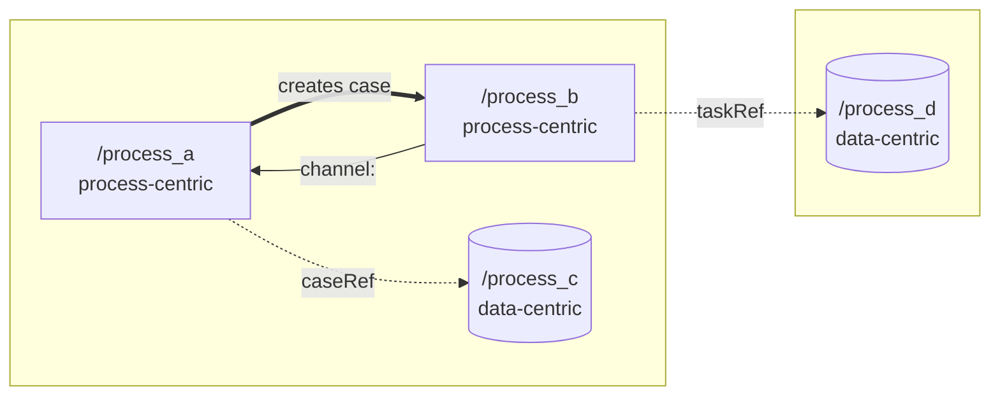

# Generate Petriflow Process

## Overview

On Netgrif the model is the implementation: a Petriflow process (a *class*)
declares data, roles, actions and a Petri net (its *lifecycle*); its runtime
instances are *cases*. An application is often a network of processes, not one
net. This skill turns a requirement into the right set of processes, each
validated.

## Critical rules

- Every Petriflow construct comes from the Petriflow MCP (schema, overview,
  examples) for the chosen Petriflow version, never from memory.
- No XML before the user approved the architecture (step 4).
- Process id = `<app_name>/<process_name>`, unique across the whole NAE
  deployment (see Applications and naming).
- `validate_process` after every change to a process file, until clean.
- Two versions, do not mix them up: the *Petriflow version* is the language
  version from `list_versions`; the *process version* is the `<version>`
  element of the XML (a new process starts at `1.0.0`).
- The process version never changes during your own iterations (fixing
  validation errors or failed test steps, refining). It is bumped once per
  user instruction to edit an already implemented process: minor for added or
  changed behavior, major for removed fields or transitions; ask when unclear.
  Redeploys during iteration use `replaceExisting` (see `test-process`).
- Deploying, creating cases and test users, and executing tasks need user
  approval (`test-process` Stage 2).

## Steps

1. **Precondition.** The `petriflow-mcp` MCP must answer. If it does not, see
   Troubleshooting; never write XML from memory.
2. **Petriflow version and language.**
    - Read `petriflow://versions` (or tool `list_versions`) and take the latest
      semver, unless the user or project pins one.
    - Read `petriflow://versions/{version}/overview`.
    - List the MCP resources and resource templates; read the schema and the
      examples for that version that match the problem (e.g. arcs, roles,
      caseRef, taskRef, user lists).
3. **Read the existing applications, then analyse the requirement.**
    - List `processes/*/` and read each application's `README.md`. Note the
      existing process ids, roles and data-centric processes; reuse them
      instead of creating duplicates.
    - When changing an existing process, note its current `<version>`, and
      compare `git hash-object` of the file with the `Hash` column of the
      application `README.md`: a difference means the user edited it in the
      builder, so read the current file and keep their changes.
    - Write down: roles (actors), data, steps, who can supply each field, how
      many users act at the same time, what users must not see of each other,
      and which data outlives one run. Ask the user for any of these that the
      requirement does not state.
4. **Make every transition atomic.** A transition is either one user filling
   one form, or a system transition with no user (P8). Split steps until this
   holds. The result is the *flat model*.
5. **Decide the architecture** with the tables below. Then present it to the
   user: each process (full id, application, kind, purpose), its roles,
   channels (sender transition → receiver system transition), caseRef/taskRef
   links, dependencies on processes of other applications, and file paths
   `processes/<app_name>/<process_name>.xml`. **Write no XML until the user approves the architecture.** A single
   process
   still goes through this gate (one short line is enough). State the process
   version of each process in it: `1.0.0` for new ones, old → new for changed
   ones (rule in Critical rules).
6. **Write the XML**, data-centric processes first, then the processes that
   reference them. Follow the schema and the naming rules below. Per process:
   places, transitions, arcs, roles and permissions, data, forms (data groups,
   laid out as in Form layout), event stubs. Channels and taskRef embedding:
   see Quick reference. Set`<version>` by the rule in Critical rules.
7. **Actions.** Before the first action, ask the user once per session:
   "Should the actions be written by a subagent, or inline here?" Then, for
   each action, use the `generate-action` skill (in a subagent if chosen) and
   pass: process file path, event and phase, what the action must do, and the
   ids of fields/transitions/processes it uses.
8. **Test regularly** with the `test-process` skill:
    - Stage 1 (`validate_process`) after each process file is written or
      changed, and after each batch of actions. Fix and re-validate until clean.
    - Stage 2 (live run on local NAE) once at the end, only with the user's
      approval. Deploy referenced processes before the ones that reference them,
      also across applications. Redeploys while iterating use `replaceExisting`
      and leave the process version unchanged (see `test-process`). When the
      process has role permissions or user bindings, Stage 2 includes role
      scenarios with impersonated test users. Every scenario cleans up its test
      cases and users; the processes stay deployed.
9. **Review** against the checklist in `references/modeling-principles.md`.
   Fix violations or list them with a reason. Per-user visibility (P9) is
   verified by the role scenarios of `test-process`, not by reading the XML.
10. **Application README.** Create or update `processes/<app_name>/README.md`
    for every application you touched (template below), including the process
    map: update it whenever a process, channel or reference changes. Write the
    `Hash` of every process file (first 8 characters of `git hash-object
    <file>`) once per task, after validation passes.
11. **Report and hand-off** (see Output). End the last message with the "Try it
    now" block from "Hand-off to the user" in `AGENTS.md`: how to open the app,
    sign in as `admin`, try this application and ask for changes.

Before step 4, when the requirement has more than one actor or more than one
entity, read `references/modeling-principles.md`. It contains:

- Petriflow vocabulary (arc kinds, caseRef, taskRef, channel, system transition)
- the nine modeling principles P1–P9 with C1–C5 and A1–A3, as checks
- Prop. 1 (arc weights vs. runtime case counts) and Prop. 2 (one case per user)
- structural patterns: CRUD template, channel, counter, per-user case
- a worked decomposition (tutor assignment) and the review checklist

## Architecture decision

| Signal in the requirement                                                | Model it as                                                                |
|--------------------------------------------------------------------------|----------------------------------------------------------------------------|
| One flow, a fixed set of forms, roles separate users well enough         | One process                                                                |
| n users act in parallel, each on their own form, n known only at runtime | One process per user (case per user), created by the coordinator (Prop. 2) |
| Users with the same role must not see each other's data                  | Separate cases bound to their user (user list), not roles alone (P9)       |
| An entity that lives longer than one run (room, customer, contract)      | Data-centric process on the CRUD template (P6)                             |
| Groups of transitions that share no data field                           | Separate processes joined by channels (P1, P2)                             |
| The same form needed in several processes                                | Define it once, embed it with taskRef (P5)                                 |
| A whole service (OCR, external system)                                   | Module (`write-module`), not a process                                     |

Every cut costs a channel. Cut only when a row above applies.

## Applications and naming

An application is a folder `processes/<app_name>/` with process XMLs and a
`README.md`. It only separates business logic: all deployed processes can
reference each other, regardless of application.

| Rule             | Value                                                                               |
|------------------|-------------------------------------------------------------------------------------|
| Application name | snake_case; the folder name equals it                                               |
| Process id       | `<app_name>/<process_name>`, both parts snake_case, e.g. `room_booking/reservation` |
| Uniqueness       | Unique across the whole NAE deployment: check every `processes/*/*.xml` first       |
| File             | `processes/<app_name>/<process_name>.xml`                                           |
| References       | Other processes and actions use the full id (caseRef targets, case creation)        |

Which application:

- Add to an existing application when the process serves its business area (same change driver, P1).
- Create a new application for a separate business area with its own change
  driver. Ask the user for the application name if it is not obvious.
- An entity shared by several applications (e.g. a customer) lives once, in the
  application that owns it; others reference it (P5). Treat cross-application
  references as an interface (P3, P4) and list them in the README.

Application README template (keep it this short):

````markdown
# <app_name>

<Purpose of the application in 1–2 sentences.>

## Processes

| Process id | File | Kind | Purpose | Roles | Hash |
|------------|------|------|---------|-------|------|

Hash: the file as the AI assistant last wrote or read it. A mismatch means someone
edited it since, for example in the builder.

## Process map



## Channels

<sender process.transition → receiver process.system transition: purpose, or "None.">

## Dependencies on other applications

<process id used, and how (caseRef, taskRef, creates case, channel), or "None.">

## Deploy order

1. <process ids, referenced processes first>
````

Kind is `data-centric`, `process-centric` (P6) or `standalone` (a process with
no links to other cases).

Hash is the first 8 characters of `git hash-object processes/<app_name>/<file>`.
It tracks the file content only; it is not the process `<version>`. Every process
file of the application has a row, including `menu_import.xml`.

Process map rules (a Mermaid diagram, rendered by GitHub):

- One node per process of the application, plus every process of other
  applications it uses, inside a subgraph titled with that application's name.
- Node id = process name (snake_case, no `/`). Label = full process id, `<br/>`,
  kind. Shape by kind: `[("...")]` data-centric, `["..."]` process-centric,
  `("...")` standalone.
- One arrow per relation, from the acting process to its target: `-->` a
  channel, labelled `channel: <name>`; `-.->` a caseRef or taskRef, labelled
  with the kind; `==>` creates a case, labelled `creates case`. A menu import
  is a node with `-.->` arrows labelled `menu` to the processes it exposes.
- Use only `flowchart LR`, subgraphs, these shapes and arrows, and quoted
  labels. No styling, click handlers or roles.
- A single process without links is one node and no arrows.
- The map, "Channels" and "Dependencies on other applications" must agree. The
  deploy order lists the targets of the arrows first.

## Form layout

Every form uses a grid in two columns. Take the exact element names and order
from the schema (`dataGroup`, `dataRef`, `layout`) of the chosen version.

- A `dataGroup` has `<layout>grid</layout>`. The grid is 4 units wide, so
  half width is `<cols>2</cols>` and full width is `<cols>4</cols>`. Do not use
  `<cols>1</cols>` for a column.
- Every `dataRef` carries its own `<layout>` with `x`, `y`, `rows`, `cols`,
  `offset`, `template` and `appearance`. Left column `x=0`, right column
  `x=2`. Use `<rows>1</rows>`, `<offset>0</offset>`, `<template>material</template>`,
  `<appearance>outline</appearance>` unless the requirement says otherwise.
- Put fields that belong together side by side in one row (same `y`): first
  and last name, street and number, postal code and city, date from and date
  to, amount and currency. Related fields go in the same `dataGroup`; use a
  separate `dataGroup` (with a `title`) per topic, e.g. personal data,
  address, contact.
- Full width (`x=0`, `cols=4`) for fields that need room or stand alone: long
  text (textarea), files, taskRef, buttons, i18n text, and a field with no
  partner. Do not pair unrelated fields only to fill the row.
- Rows are numbered by `y` from 0, one row per pair, with no gaps. A row with a
  single field of half width stays at `x=0`.
- Validate after laying out (`validate_process`), and tell the user the
  grouping you chose in the report.

## Quick reference

| Need                  | Source                                                 |
|-----------------------|--------------------------------------------------------|
| Versions              | `petriflow://versions` / `list_versions`               |
| Overview of a version | `petriflow://versions/{version}/overview`              |
| Schema, examples      | MCP resource list / templates for that version         |
| Action API            | `generate-action` skill (`list_actions`, `get_action`) |
| Validate              | `test-process` skill (`validate_process`)              |

- **Channel:** an action of the sender navigates one caseRef field and fires a *system transition* in the referenced
  case. A system transition has no role
  permission and no user binding; check that default/anonymous roles do not
  grant it either.
- **Counter pattern:** the coordinator waits for n per-user cases with a
  variable arc (weight = data field). The field must equal the number of cases
  actually created (Prop. 1). A skip path empties the counting places with
  reset arcs.
- **CRUD template:** `create` → places A, B; `update` loops on A; `read` on a
  read arc to B; `delete` consumes A and B.

## Examples

**Example 1: single process.**
User says: "Employees request leave, their manager approves or rejects, HR
records approved leave."
Actions: latest version and overview from the MCP → roles employee, manager,
hr → three atomic user transitions, approve/reject as a choice → no existing
application fits → architecture "new application `leave`, one process
`leave/leave_request` in `processes/leave/leave_request.xml`" approved → XML →
`validate_process` clean → `processes/leave/README.md`.
Result: one validated process, the application README and a report.

**Example 2: decomposition.**
User says: "Every tutor ranks every session slot privately, then an algorithm
assigns tutors and the associate corrects the result."
Actions: the number of tutors is runtime data and rankings are private (Prop. 2, P9) → propose application
`tutor_assignment` with a coordinating
process, one process per tutor bound to its user, and data-centric processes (slot, tutor, priority), e.g.
`tutor_assignment/tutor_priorities` → user
approves → data-centric XML first, then the coordinator and the per-tutor
process → actions via `generate-action` → validate each file → README.
Result: several validated processes with channels; see the worked example in
`references/modeling-principles.md`.

## Troubleshooting

**Petriflow MCP does not answer** (connection refused, tool missing).
Cause: server not configured for this harness, or unreachable. `.mcp.json`
uses the Claude Code format; other harnesses need their own MCP configuration.
Solution: tell the user and stop. Do not write XML from memory.

**`petriflow://versions` cannot be read.**
Cause: the client does not support MCP resources.
Solution: use the tools instead (`list_versions`, then the tool that returns
the overview or schema, as listed by the server).

**Resource URI for the schema or examples is unknown.**
Cause: URIs differ per server version.
Solution: list resources and resource templates and pick the one for the
chosen version. Never guess a URI.

**`validate_process` fails on constructs of an older Petriflow version**
(e.g. when changing an existing process).
Cause: the file was written for an older release.
Solution: follow `test-process`: report it and ask whether to migrate or to pin
the older version. Do not decide silently.

**Validation or deployment rejects the `/` in the process id.**
Cause: the schema or the engine restricts the characters of a process id.
Solution: stop and ask the user. Do not switch to another separator on your
own; the convention is project-wide.

**The process id already exists** (in `processes/` or on the engine).
Cause: ids are unique across the whole NAE deployment.
Solution: if it is the same process, change that file instead; otherwise pick
another process name and confirm it with the user.

**Deploy fails because the same process id and version is already deployed.**
Cause: an iteration redeploys the same `<version>` without `replaceExisting`;
the engine refuses that.
Solution: do not bump the version. Check `list_processes`, then redeploy with
`replaceExisting: true` as described in `test-process`.

## Output

Petriflow version used; process versions (new, unchanged, or old → new); the approved architecture (applications, full
process
ids); files written, including application READMEs; per file the
`validate_process` result (issues → fixes → clean); actions written;
Stage 2 result (including replaced processes and the role scenario matrix) or
why it did not run; principle
deviations with reasons; then the "Try it now" hand-off block from `AGENTS.md`.

## Common mistakes

- Writing XML before the user approved the architecture.
- Hardcoding a Petriflow version or copying the version/syntax of an old process.
- One process with a copied transition per user (`approve_user_1..n`) when the
  number of users is runtime data.
- Privacy through one shared role plus "users promise not to look".
- An action that fires a user task or writes foreign fields that arcs depend
  on, instead of firing a system transition (channel).
- A variable arc whose weight is not tied to the number of cases created.
- An action touching two or more other cases without failure handling (A3).
- A data-centric process whose actions create, delete or call other cases.
- Skipping `validate_process` after a change, or validating the old file.
- A form with all fields stacked in one column, or unrelated fields paired in
  one row.
- A process id without the application prefix, or a prefix that does not match
  the folder name.
- A new data-centric process for an entity another application already owns.
- Forgetting to create or update the application `README.md`.
- A process map that is missing or out of sync with the Channels and
  Dependencies sections.
- Editing an existing process file from a stale copy, without the hash check,
  and so overwriting the user's builder changes.
- Forgetting to update the `Hash` column after the last write of a task.
- Ending with a technical report only, so the user does not know how to open
  and try the app.
- Bumping the process version during your own iterations, or to get around a
  refused deploy.
- Not bumping the process version when the user gave a new instruction to edit
  an implemented process.
- Mixing up the Petriflow version and the process `<version>`.
