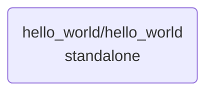

# hello_world

Example application. It asks for a name, builds a greeting with an action, and
then asks whether the user is done; if not, it starts over.

## Processes

| Process id                | File              | Kind       | Purpose                                  | Roles                      | Hash       |
|---------------------------|-------------------|------------|------------------------------------------|----------------------------|------------|
| `hello_world/hello_world` | `hello_world.xml` | standalone | Greet the user, repeat until they finish | default and anonymous role | `f1c0fac1` |

Hash: the file as the AI assistant last wrote or read it. A mismatch means someone
edited it since, for example in the builder.

## Process map

## Channels

None.

## Dependencies on other applications

None.

## Deploy order

1. `hello_world/hello_world`
